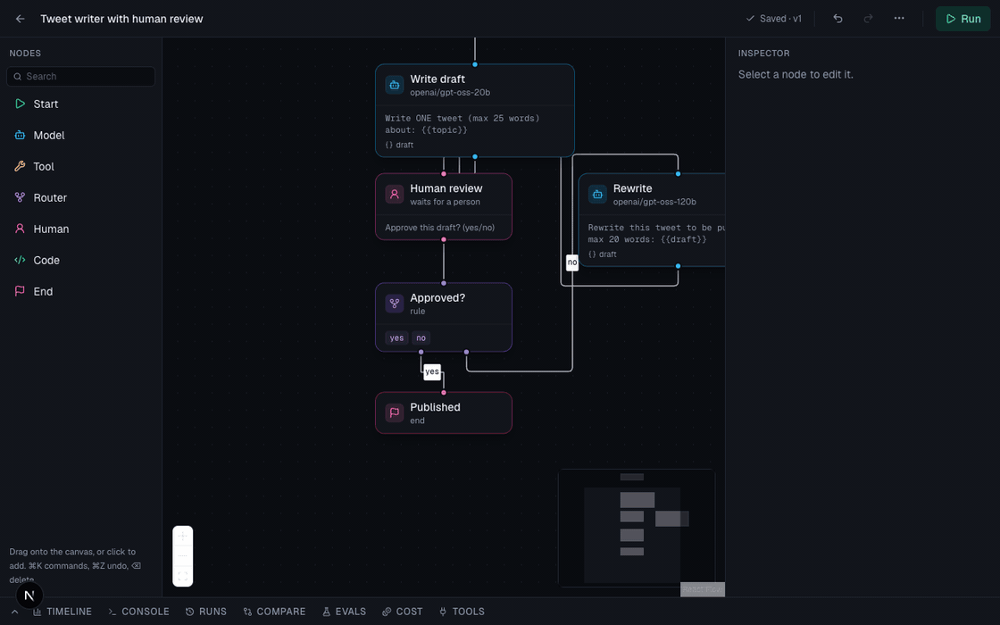
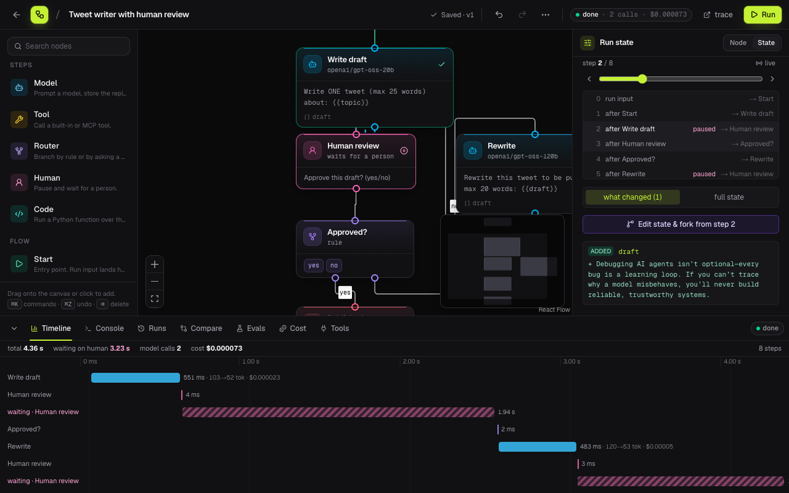
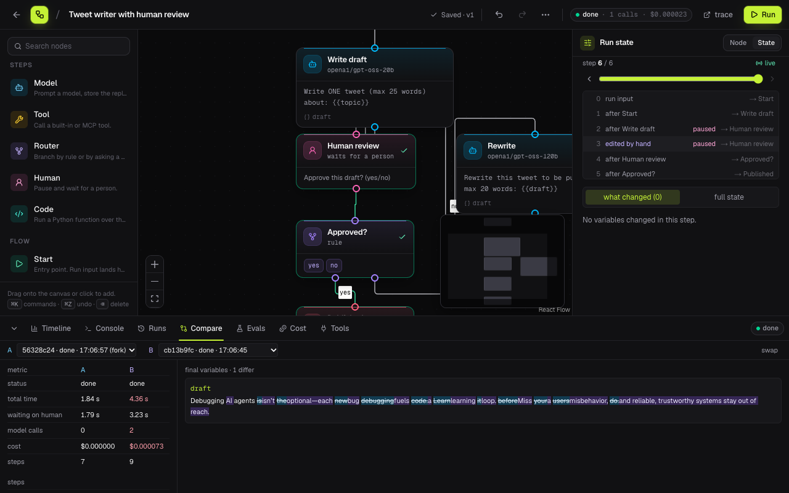
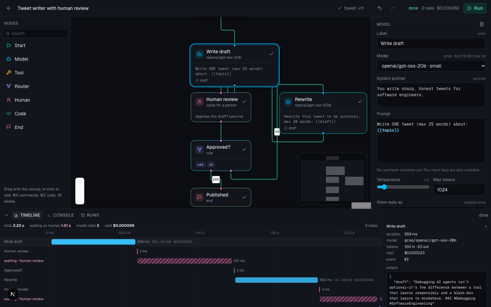
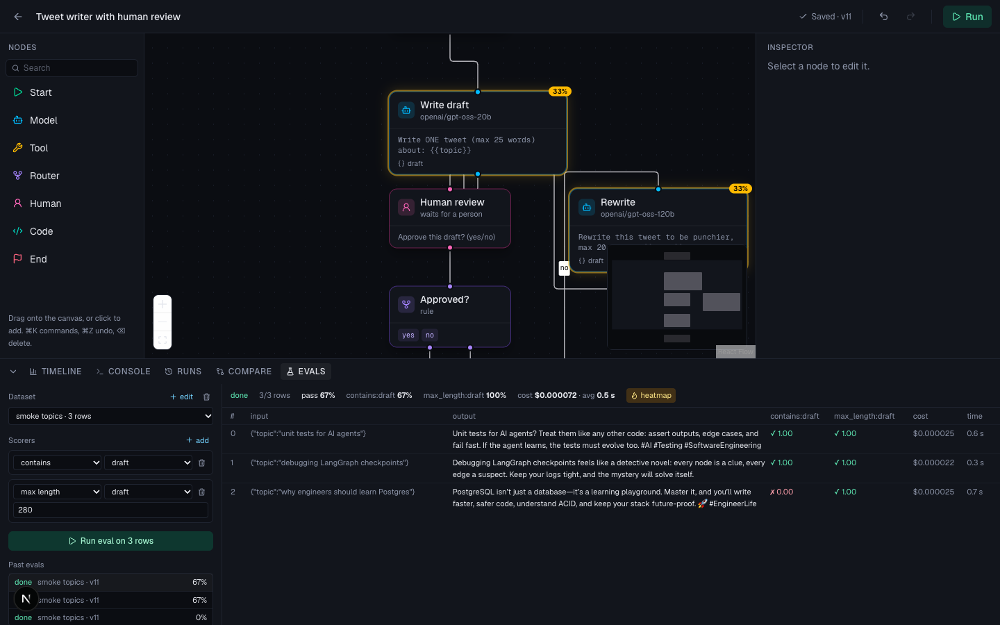
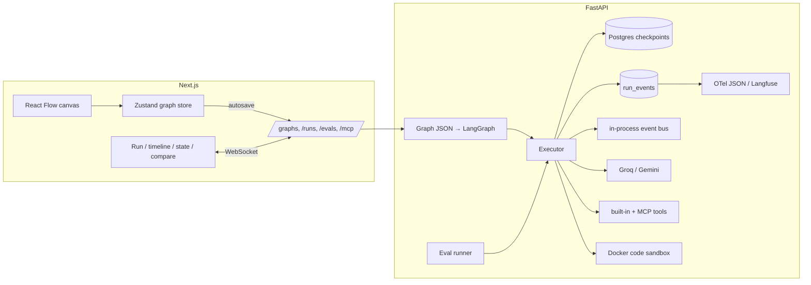

# Agent Studio

**Build, run and debug multi-agent workflows on a canvas. Pause any run, edit its state, fork it from that step, and compare the two.**

Most agent tools let you *build* a graph or *view* a trace. Agent Studio is the debugger in between: every run is checkpointed, so you can scrub back through it, change a variable, and continue from that exact point in a new run while the original stays untouched. Evals, model sweeps, MCP tools and cost tracking are built in.

**Live demo:** [agent-studio-rouge-eta.vercel.app](https://agent-studio-rouge-eta.vercel.app) · API on a free Render instance, so the first request after idle can take ~50 s.



## What you can do

| | |
|---|---|
| **Canvas** | Seven node types: model, tool, router (rule or model-driven), human gate, code, start, end. Inspector forms with Monaco editors, `{{variable}}` highlighting, undo/redo, autosave, ⌘K command palette. |
| **Run** | Tokens stream inside the node that is generating them. Edges animate as data flows. Human nodes pause the run and show the reviewer exactly the variables they need. |
| **Time travel** | Scrub through every checkpoint, see what each step changed (word-level diff), **edit the state and fork a new run from that step**. Runs form a tree; any two runs can be compared side by side. |
| **Evals** | Datasets × graph → scored rows (`exact`, `contains`, `regex`, `json`, `max length`, LLM judge). Failures are attributed to the node that wrote the graded variable and shown as a heatmap on the canvas. |
| **Model sweeps** | Run the same eval once per candidate model for one node; the cheapest model within 5 points of the best pass rate is recommended and can be applied with one click. |
| **MCP** | Connect any Model Context Protocol server (stdio or HTTP); its tools become tool nodes. |
| **Observability** | Retries are visible on the node and in the console. Every run exports as an OpenTelemetry-style trace; with Langfuse keys, traces and eval scores are pushed automatically. |
| **Cost** | Per-node and per-model calls, tokens, p50/p95 latency and cost over recent runs, with a monthly projection. |
| **Sandbox** | Code nodes run in a throwaway Docker container: no network, memory and pid caps, read-only filesystem, hard timeout. |
| **Share** | Templates gallery, JSON import/export, duplicate, read-only share links with "copy to my graphs". |
| **Triggers** | Every graph has a signed webhook URL: POST a JSON object and a run starts with it as input. Connect your own Telegram from the Triggers tab and runs that pause at a human node arrive on your phone with answer buttons; pressing one resumes the run. `http_post` and `telegram_send` tools push results back out, so a whole loop can run without the browser. |

<p>
 
</p>
<p>
 
</p>

## How time travel works

Each node completion is a LangGraph checkpoint stored in Postgres. A **run** in Agent Studio is a pointer to the head of a checkpoint chain, plus the events it emitted. Forking calls `update_state` on the chosen checkpoint with your edits, which creates a new checkpoint whose parent is the old one, then continues from there. Both runs share the thread; each keeps its own lineage by walking parent pointers from its head. Replay on the canvas is a pure function of (checkpoints, index): no model calls, no server round trips while you scrub.



Design choices worth knowing:

- **Everything is derived from events.** Console, canvas status, timeline, cost stats and traces all read the same `run_events` table. Reconnect with `?after=<seq>` and nothing is lost or duplicated.
- **Drafts are always saveable.** Structural problems (a node with no outgoing edge, router branches without edges) are lint issues returned on save, not errors. Runs are refused until the issues are fixed.
- **Evals run real runs.** Every dataset row is an ordinary run: it shows in the run list, has checkpoints, and can be forked like any other.
- **The sandbox is a process boundary, not a builtins whitelist.** Trimming builtins is not isolation; a container is.

## Cost and latency

Measured on the tweet-review example over recent runs, Groq free tier, list prices:

| | gpt-oss-20b | gpt-oss-120b |
|---|---|---|
| avg latency | ~0.6 s | ~0.7 s |
| p95 latency | ~0.7 s | ~0.9 s |
| cost per call | ~$0.000024 | ~$0.000076 |

A full run (draft → human → rewrite → approve) costs about **$0.00007**, roughly **$0.70 per 10,000 runs**. The Cost tab computes these numbers live for any graph; the model sweep found that 20b matched 120b on the tweet eval at a third of the price.

## Run it locally

```bash
git clone https://github.com/HardCoder404/agent-studio && cd agent-studio
cp .env.example .env            # add GROQ_API_KEY (free at console.groq.com)
docker compose up -d            # Postgres on :5433

cd apps/api && uv sync && uv run alembic upgrade head && uv run uvicorn app.main:app --reload   # :8000
cd apps/web && npm install && npm run dev                                                       # :3000
```

Open http://localhost:3000, pick a template, press Run. Optional: `GEMINI_API_KEY` for a second provider, `LANGFUSE_PUBLIC_KEY` / `LANGFUSE_SECRET_KEY` for hosted tracing, Docker Desktop running for the code sandbox (otherwise `CODE_SANDBOX=inprocess`).

Full stack in containers: `docker compose --profile full up --build`. Deploying on free tiers (Vercel + Render + Supabase): [docs/deploy.md](docs/deploy.md).

## Tests

```bash
cd apps/api && uv run pytest            # 61 tests: engine, checkpoints, forks, evals, sweeps, MCP, sandbox, traces
cd apps/web && npm test                 # unit tests for timeline, diff and graph helpers
cd apps/web && npm run e2e              # Playwright against a live stack: run → gate → fork → compare, share links
```

CI runs lint, unit tests, the production build and an eval smoke test with a scripted model, so no API keys are needed.

## Stack

Next.js 16 · React 19 · React Flow · Zustand · Monaco · Tailwind v4 — FastAPI · LangGraph · SQLAlchemy · Alembic · Postgres — Groq · Gemini · MCP SDK · Langfuse · Docker

## Limits and next steps

- Traces reach Langfuse when a run reaches a resting state, not token by token.
- Failure attribution in evals is a heuristic (the node that writes the graded variable).
- The code sandbox starts a container per call (~300 ms); a warm pool would hide that.
- No multi-user auth yet: share links are capability URLs. GitHub sign-in and per-user graphs are next, followed by realtime collaboration on the canvas and scheduled runs with webhooks.

## License

MIT
